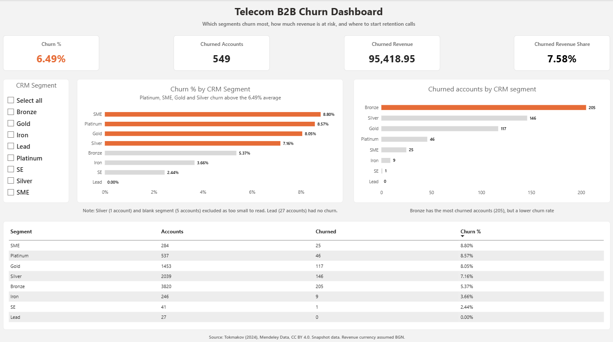
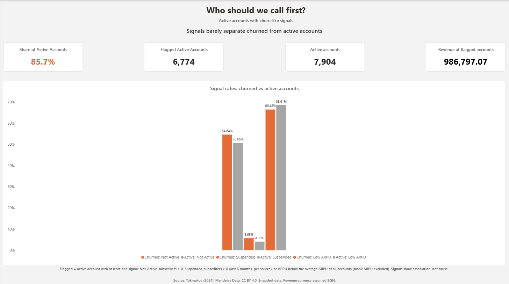

# Telecom B2B Customer Churn Analysis

**Status:** Data quality checks, SQL analysis and a two-page Power BI dashboard are complete. Excel cross-check is saved in `outputs/`.

## 1. Business question

**Which B2B customer segments have the highest churn, how much revenue has been lost to churn, and which active accounts show churn-like signals that should be prioritised for retention calls?**

**Stakeholder:** B2B retention and account management team.

**Why it matters:** Retention calls cost time. The team needs to know where churn is concentrated, how much revenue is at stake, and which accounts to contact first.

**Scope note:** The dataset is a single snapshot, so this project measures churn that has already happened and compares active accounts with churned ones. It is not a churn prediction model.

## 2. Dataset

- **Source:** Tokmakov, D. (2024). *Customer Churn Dataset containing real records from a leading Bulgarian telecom operator, specifically for business customers, including small, medium, and large companies.* Mendeley Data, V1. Published 11 Nov 2024. Contributor affiliation: Plovdiv University "Paisij Hilendarski".
- **Authenticity:** The dataset page describes the records as real and as generated by the telecom's business information system. This is the author's statement. This project has not verified it independently.
- **Licence:** CC BY 4.0 (checked on the source page). Attribution is required, so the citation below is included.
- **Citation:** Tokmakov, D. (2024). Customer Churn Dataset containing real records from a leading Bulgarian telecom operator, specifically for business customers, including small, medium, and large companies. Mendeley Data, V1. doi: 10.17632/nrb55gr66h.1. Link: [https://data.mendeley.com/datasets/nrb55gr66h/1](https://data.mendeley.com/datasets/nrb55gr66h/1)
- **Size:** 8,453 data rows and 14 columns. The CSV file has 8,454 lines including the header. The source page states 8,454 instances, which appears to count the header line. Confirmed by line count and CSV parse.
- **Column count:** The source page lists 14 attributes and 1 target attribute. The CSV has 14 columns, including the target column `CHURN`.
- **Type:** Snapshot. Each row is one business customer record. Six PIDs appear more than once (see check 3).
- **Field definitions (from source page):**
  - `CHURN`: customer churned to another telecom (Yes/No).
  - `Not_Active_subscribers`: number of non-active subscribers for this PID. The source does not explain blank values.
  - `Suspended_subscribers`: suspended subscribers in the last 6 months.
  - `ARPU`: average revenue per user (subscriber).
  - `KA_name`: name of the Key Account Manager.
  - `TotalRevenue`: total revenue from the business customer. The source names the mobile and fixed columns "average", but the checks show that they add up to `TotalRevenue` (check 7). This project treats all three as totals. Confirm with the data owner if possible.
- **Currency:** Not stated in the source. The data comes from Bulgaria, and the Bulgarian lev (BGN) was the currency in 2024. Revenue is assumed to be in BGN. This is an assumption, not confirmed by the source.
- **Privacy:** The `KA_name` column has 12 distinct values, 4 of which are person names. The column is removed from the Power BI model. Person names are not included in this repository. The raw CSV is not included either.

**Main columns:** PID, CRM_PID_Value_Segment, EffectiveSegment, Billing_ZIP, KA_name, Active_subscribers, Not_Active_subscribers, Suspended_subscribers, Total_SUBs, AvgMobileRevenue, AvgFIXRevenue, TotalRevenue, ARPU, CHURN.

## 3. Data quality checks

All checks are in `sql/00_verify_import_and_quality.sql`.

| # | Check | Result | Action |
| --- | --- | --- | --- |
| 1 | Row count | 8,453 data rows (8,454 lines including header) | Matches the source file. The source page's 8,454 appears to count the header |
| 2 | Blank values | Segment 5, ZIP 2, ARPU 1, Not_Active 4,149, Suspended 8,101 | Documented. Blank Not_Active and Suspended are treated as 0, see Limitations |
| 3 | Duplicate PIDs | 6 PIDs, 23 rows | Flagged, not deleted |
| 4 | PID format | 26 PIDs in scientific notation (e.g. 1.29E+12), 89 PIDs with an "SMB" suffix | Kept as-is. Format is mixed, so PID is not used as a numeric key |
| 5 | Churn values | Yes 549, No 7,904 | Valid |
| 6 | Subscriber totals | Active + Not_Active + Suspended = Total_SUBs | 0 mismatches |
| 7 | Revenue totals | AvgMobileRevenue + AvgFIXRevenue = TotalRevenue | 0 mismatches |
| 8 | ARPU | TotalRevenue ÷ Active_subscribers matches ARPU within 0.01 for 8,330 of 8,452 comparable rows | 122 rows do not match. Documented, not corrected. 1 row has blank ARPU and is excluded |
| 9 | Segment typo | "Sliver" appears in 1 row | Kept separate in the output. Too small to draw a conclusion |
| 10 | Blank segment | 5 rows | Kept as a separate group. Too small to draw a conclusion |
| 11 | KA_name | 12 distinct values, 4 of them person names | Person names are not included in this repository. Column removed from the Power BI model |
| 12 | Excel cross-check | Row count, churn counts, revenue totals, churn %, churned revenue share and blank counts match SQL | See `outputs/p2_excel_validation.xlsx` |
| 13 | Blank PID | SQL: 0. Excel: 0 after importing PID as Text | An earlier Excel import showed 89 blanks. After importing PID as Text, the blanks disappeared. The cause was the Excel import, not the data |
| 14 | Blank Not_Active | 4,149 rows with blank Not_Active | Treated as 0 in all calculations |

## 4. Findings

Numbers come from the SQL queries in `sql/01_analysis_queries.sql`. The same numbers appear in the Power BI dashboard.

**Finding 1: Overall churn is 6.49%.**

549 of 8,453 accounts have churned.

**Finding 2: Churn is higher in Platinum, SME, Gold and Silver than in Bronze and Iron.**

| CRM segment | Accounts | Churned | Churn % |
| --- | --- | --- | --- |
| SME | 284 | 25 | 8.80% |
| Platinum | 537 | 46 | 8.57% |
| Gold | 1,453 | 117 | 8.05% |
| Silver | 2,039 | 146 | 7.16% |
| Bronze | 3,820 | 205 | 5.37% |
| Iron | 246 | 9 | 3.66% |
| SE | 41 | 1 | 2.44% |
| Lead | 27 | 0 | 0% (small sample) |
| Sliver | 1 | 0 | Too small to read |
| Blank | 5 | 0 | Too small to read |

Bronze has the most churned accounts (205), but its churn rate is lower. Volume and rate tell different stories, so both are shown on the dashboard.

**Finding 3: Churned accounts carry 7.58% of total revenue.**

Churned accounts carry 95,418.95 of the 1,258,086.54 total revenue.

**Finding 4: Churned accounts are larger on average.**

| Measure | Churned (Yes) | Active (No) |
| --- | --- | --- |
| Average TotalRevenue | 173.81 | 147.11 |
| Average Total_SUBs | 11.72 | 9.84 |
| Average ARPU | 25.00 | 24.40 |

Churned accounts have more subscribers and higher revenue on average. Their ARPU is almost the same. This shows which accounts churn, but not why.

**Finding 5: The churn-like signals are weak.**

Low ARPU means ARPU below the average ARPU of all accounts. Blank ARPU is excluded.

| Signal | Churned | Active |
| --- | --- | --- |
| Not_Active > 0 | 54.64% | 50.66% |
| Suspended > 0 | 5.65% | 4.06% |
| Low ARPU | 66.48% | 68.61% |

The gap between churned and active accounts is small for every signal. Churned accounts are slightly less likely to be below average ARPU. None of the signals separates the two groups well.

**Finding 6: The signal-based list is too broad to target.**

6,774 active accounts (85.7% of active accounts) show at least one signal. They carry 986,797.07 of revenue, about 84.9% of active revenue. The active revenue figure is calculated as 1,258,086.54 − 95,418.95 = 1,162,667.59, so the share is 986,797.07 ÷ 1,162,667.59. This is too many accounts for a retention priority list.

## 5. Dashboard

The dashboard has two pages. Both use the same data and the same measures as the SQL queries.

**Page 1: Churn Overview** answers *where* churn is and *how much* revenue it has cost.

- 4 KPI cards: Churn %, Churned Accounts, Churned Revenue, Churned Revenue Share.
- Churn % by CRM segment, with segments above the 6.49% average highlighted.
- Churned accounts by CRM segment.
- Segment slicer. The KPI cards are not affected by the slicer, so they always show the overall totals.
- Table with accounts, churned accounts and churn % for each segment.

**Page 2: Retention Priority** answers *which active accounts to call first*.

- 4 KPI cards: Active accounts (7,904), Flagged Active Accounts (6,774), Revenue at flagged accounts (986,797.07), and Share of Active Accounts (85.7%).
- Signal rate chart: churned and active accounts side by side for each signal.
- Headline: signals barely separate churned from active accounts.
- The flagged list is not used as a call list, because it covers 85.7% of active accounts (see Finding 6).

## 6. Recommendations

1. **Prioritise active accounts in Platinum, SME, Gold and Silver for retention review.** These segments churn above the overall 6.49%. Churned accounts also have higher average revenue across all accounts (173.81 vs 147.11).
2. **Do not use the current signals alone to pick calls.** Agree on a tighter rule with the business team, and test it on churn history before using it.
3. **Collect monthly snapshots.** A single snapshot cannot show which accounts changed status before they churned. Monthly data would make that comparison possible.
4. **Check the data at source.** Confirm the meaning of blank Not_Active and Suspended values, the 122 ARPU mismatch rows, and the PID format.
5. **Ask account managers why larger accounts churn.** The data shows the pattern, but not the cause.

## 7. Limitations

- **Snapshot data:** There is no time history, so this analysis shows where churn is, not when it will happen.
- **Weak signals:** The signals in Finding 5 barely separate churned from active accounts.
- **Broad flag:** Finding 6 covers most active accounts. The low-ARPU rule uses the average ARPU as its threshold. About two-thirds of active accounts (68.61%) and churned accounts (66.48%) fall below it. A median threshold would split the accounts differently and was not tested.
- **Threshold scope:** The average ARPU threshold is calculated over the whole table. If a filter or slicer is added to page 2, the threshold can change. The current page has no such filter.
- **Blank values:** The source does not define blanks. Blank Not_Active and Suspended are treated as 0. This is an assumption. Blank ARPU is excluded from the low-ARPU rule.
- **Suspended definition:** The source describes Suspended_subscribers as the number in the last 6 months. The time window is not the same as the snapshot.
- **ARPU mismatch:** 122 rows do not match TotalRevenue ÷ Active_subscribers. They are kept as they are.
- **Revenue column names:** The source describes TotalRevenue as total revenue from the business customer, and the mobile and fixed columns add up to it. This project reads them as totals. Not confirmed with the data owner.
- **Small groups:** Lead, SE, Sliver and blank segments are too small for reliable percentages.
- **Averages:** Average values can be pulled by large accounts. Medians were not calculated.
- **Causation:** This analysis finds patterns, not causes.
- **Currency:** Not stated in the source. Revenue is assumed to be in BGN, which is not confirmed. Totals and averages are in the dataset's currency unit.
- **Authenticity:** The data is described by the author as real records. This project has not verified that claim.

## 8. Tools

- **SQL Server (T-SQL):** Import, data quality checks and analysis queries.
- **Excel:** Cross-check of row counts, churn counts, revenue totals, churn percentages, churned revenue share and blank counts.
- **Power BI Desktop:** Two-page dashboard connected to the SQL Server table in Import mode. Measures cover churn %, churned accounts, churned revenue, churned revenue share, flagged active accounts, share of active accounts, and the churned and active signal rates.

## 9. Project structure

- `sql/00_verify_import_and_quality.sql`: 14 data quality checks
- `sql/01_analysis_queries.sql`: 6 business questions
- `outputs/p2_excel_validation.xlsx`: Excel cross-check against SQL results
- `powerbi/telecom_churn_dashboard.pbix`: Power BI dashboard, two pages. Import mode, so the file contains the imported table (without the `KA_name` column). Refreshing it needs the local SQL Server database.
- `images/telecom_dashboard_page1.png`: Page 1 screenshot
- `images/telecom_dashboard_page2.png`: Page 2 screenshot
- `data/`: raw CSV (not included, see `.gitignore`)

**How to reproduce:**

1. Import the CSV into a SQL Server table named `telecom_customers` in a database named `telecom_churn`.
2. Run `sql/00_verify_import_and_quality.sql`. Results should match the expected values in each query's comments.
3. Run `sql/01_analysis_queries.sql`.
4. Optional: open `powerbi/telecom_churn_dashboard.pbix`. It points to `localhost\SQLEXPRESS`, database `telecom_churn`, table `dbo.telecom_customers`.
